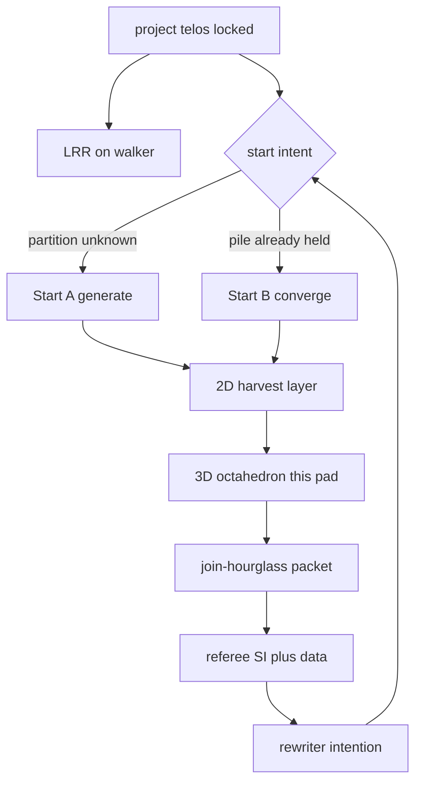
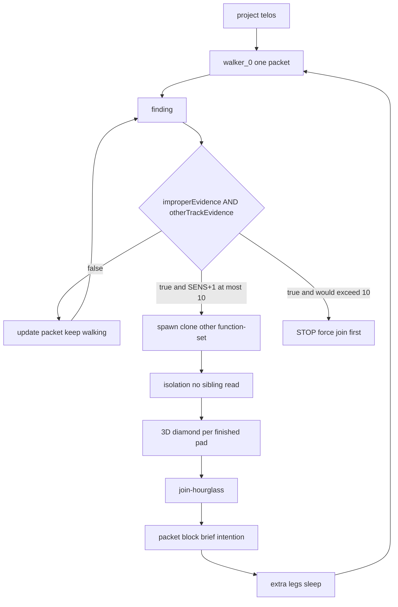
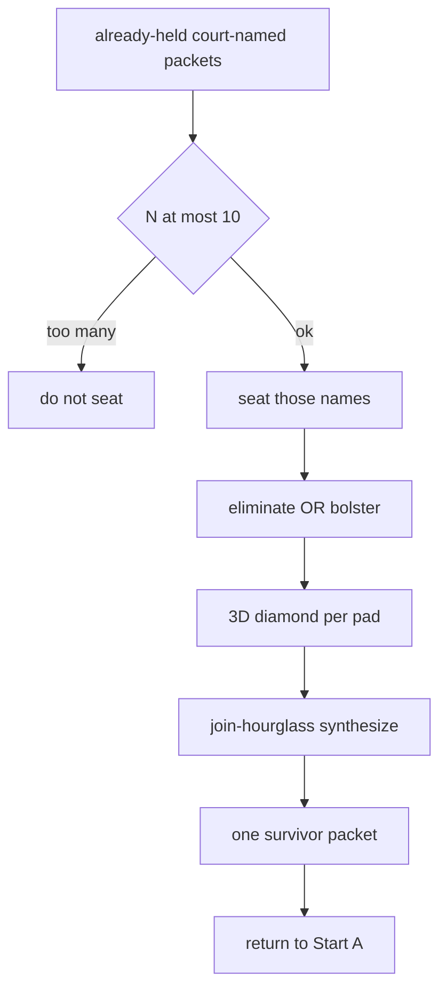
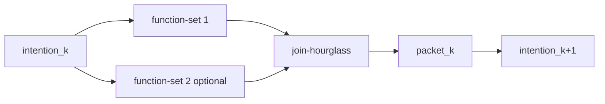
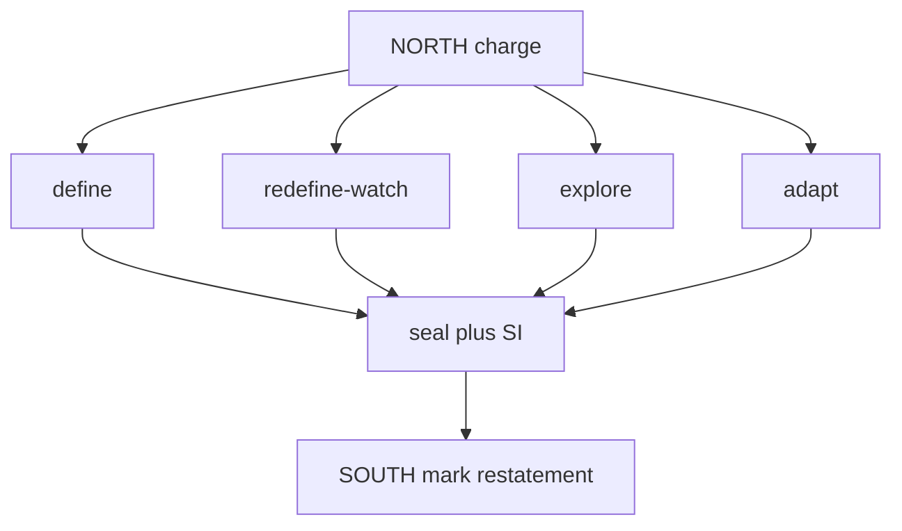
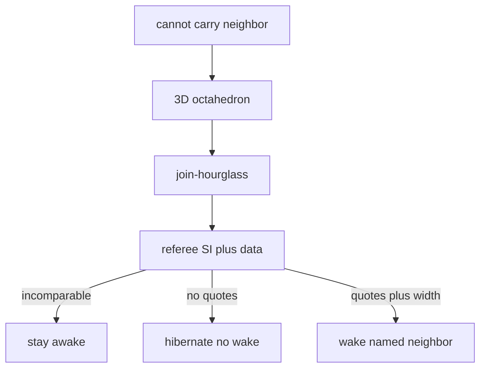
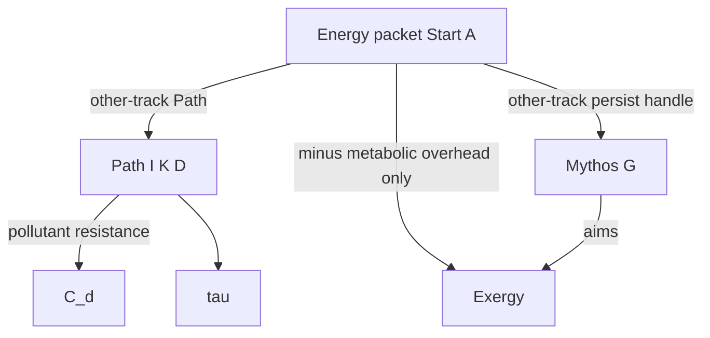

# TwinGlass lattice — technical spec sheet (Grok Build)

**Class:** WORKING  
**Date:** 2026-09-15  
**For:** Grok Build CLI / grok.com Build configuring `Fractal-Deployment/twinglass-pack`  
**Repo:** https://github.com/Fractal-Deployment/twinglass-pack  
**Engine:** `engine/main-lattice.ts` + `engine/diamond-engine.ts` + `engine/diamond3d.ts`  
**Court pointer:** `Fractal-Deployment/llmve-meaning` `VERSION` file (living tip 0.8.2). D1 meaning. This sheet is D2 methodology.  
**Project telos:** measure interdependent viability of a transformer LM under real constraints.

This sheet is the configuration charge for Build. It is not meaning-court. It does not graduate a leaf. It does not rewrite LLMVE meters.

Pack `APPARATUS.md` still titles “two lattices.” Operator intent (this sheet): **one apparatus, two start intents**. After start, one gait. Keep pack spawn lock, isolation, cap 10, mutex, SI+LCD monitor cap.

---

## 0. Build install (do first)

Follow pack `GROK_BUILD_CLI.md`. One source of truth: plugin **or** `~/.grok/skills`, not both.

After install, session charge is this sheet **plus** pack `commands/run-apparatus.md`, with the identity correction in §1.

Do not load on the same charge:

- `twinglass-lattice` and `twinglass-twin`
- `morph-shared` / `deep-think` / `deep-research` / `argueforge`
- LRR on the sentinel (overload refuse)

Load:

| Role | Skill / command |
|------|-----------------|
| research walker | `logic-ration-reason` |
| working prompt | `honest-prompt-rewrite` |
| glossary | `lcd-glossary-integrity` |
| sentinel only | SI + `lcd-lens` (two-object cap) |
| Start A / Start B walk | `twinglass-lattice` + `commands/run-apparatus.md` |
| join after isolation | `collate-hourglass` |
| exclusive leftover only | `steelman-truth-tournament` |
| named Reason vs Disconfirm gutter only | `twinglass-twin` (separate charge) |

Slash commands that must exist: `/activate`, `/twinglass-lattice`, `/twinglass-twin`, plus pack `commands/*.md`.

---

## 1. Apparatus identity (Build must implement this, not the mashed title)

```text
ONE apparatus
  Start A  generating function   partition of the space unknown
  Start B  converging function   pile of court-named packets already held
AFTER START — one gait
  2D diamond layer     harvest (width lives here)
  3D diamond           octahedron critique of ONE pad (width +0)
  join-hourglass       packet product
  referee              SI + data comparability; authorizes wake
  rewriter             next intention; project telos stays
OPTIONAL
  manifold-hourglass   narrow a held stack (critic, not a meter)
  twin                 leftover exclusive gutter; XOR lattice
WIDTH
  live walkers only
  default 1
  cap 10 = STOP over cap   (engine SENS_CAP = 10; CLI practical ~8)
```

Charge picks **one** start intent. After B’s first synthesis, return to A on the survivor.



---

## 2. Occupants vs legs (width rule)

Occupants are roles. They are not width.

| Occupant | Job | Engine / command |
|----------|-----|------------------|
| walker | writes one pad under LRR | `diamond-engine` walker / clone |
| observer | matches finished pads when a meet is due | run-apparatus step 7 |
| referee | SI + LCD + plane tags + units | `integrity-agent` + `lcd-lens` |
| rewriter | next intention; project telos unmoved | `honest-prompt-rewrite` |

Legs = live walkers. Width = count of live walkers. 3D diamond and both hourglasses add zero width.

Board fields Build must print each turn (`commands/run-apparatus.md`):

```text
LEGS:
SENS:
CAP: 10
STOP_OVER_CAP:
DIAMOND_MUTEX:
AWAITING_MEET:
MEET: debate | synthesis | waiting
SPAWNED_FROM_HARD_NOTES:
SPAWN_REFUSED:
SIBLING_SESSION_HUNT: false
MINTED_DUMP_METER: false
START_INTENT: A | B
RESTATE:
```

If `SENS > 10`: STOP. Hibernate. Do not spawn 11.

---

## 3. Start A — generating lattice

**When.** Partition unknown. One walker, one packet, project telos held.

**Spawn predicate** (`engine` `assertLegalSpawnNote` / `commands/cli-spawn-lock.md`):

```text
legal_spawn := improperEvidence AND otherTrackEvidence
cannotFollow alone := not a spawn
assigned_opposite := SPAWN_REFUSED
synonym_of_live_lane := SPAWN_REFUSED
false_assigned_persona := improper-track evidence
```

Parent keeps walking. Clone isolated. Same conclusion allowed. New evidence **transforms** a sleeping packet that was locally correct.



CLI: `commands/cli-spawn-lock.md`, `commands/fork-sens.md`, `engine/main-lattice.ts`.

---

## 4. Start B — seated-N converge

**When.** Operator already holds court-named packets and is unsure which neighbor to walk.

Each seated name: eliminate **or** bolster. Then one synthesis. Concepts are not required to die. A coordinate may survive.



N = size of the already-named pile. Filling cap 10 is not an init ritual.

Not seatable: Proof, Disproof, Helmholtz, Labor-empty, Shape-as-capacity, assigned-enemy identities.

---

## 5. 2D diamond — harvest layer

Shape: rhombus. Split then join. This is the walk. Width lives here.

Not dialectic. Not thesis vs assigned-antithesis.

```text
layer_k:
  intention_k
  harvest set H = function-sets, not camps
  isolate until endpoint
  join-hourglass
  packet_k
  3D diamond critiques packet_k
  legs of layer_k sleep
```

Default `|H| = 1` (one walker sequential). `|H| = 2` only if one pad would clutter. Larger only under spawn lock and cap. No fixed number of layers.



Packet fields the same walker writes:

```text
thesis_expression
negation_map[]     observations that would count against the thesis
                   not “the opposite people”
```

---

## 6. 3D diamond — octahedron critique

Pack `engine/diamond3d.ts`: “3D diamond = octahedron. Four equatorial paths, then a mark. Not a 2D rhombus.”

Not a spawn. Not five critique children. Mutex: `commands/diamond-mutex.md`.

```text
NORTH   charge in, glossary in
define            lock referent
redefine-watch    hunt silent rename
explore           follow developed information
adapt             reroot working prompt; project telos stays
SOUTH   mark after all four sealed: integrity | shift
        restatement, not a refusal
```

After each seal: sentinel projects SI + LCD only. LRR stays on the walker. Hibernating pad cannot append, seal, or read. Clone cannot read sibling before mark.



Evidence-for may sit on define+explore. Evidence-against may sit on redefine-watch. Faces, not groups.

---

## 7. Hourglasses

| Tag | When | Job | Skill |
|-----|------|-----|-------|
| join-hourglass | after isolated endpoints / south marks | expand gaps → debate or synthesis → contract packet | `collate-hourglass` |
| manifold-hourglass | broad stack already held | internal patterns as critic; then fill gaps | not a meter |

Internal conceptualization ≠ 3D critique. Internal patterns do not stamp Exergy, Energy identity, or Ω.

Steelman only if accounts remain exclusive after debate.

---

## 8. Sleep door, wake, packet



Referee does not invent the next directive. Hibernate via `commands/hibernate-ab.md`. Session-log hunt is contamination (`hooks/deny-session-read.sh`).

```text
packet:
  name
  plane_tag          selection | activation | mythos
  word_problem
  candidate_form
  thesis_expression
  negation_map[]
  empty_meets[]
  why_neighbor
  improperEvidence?
  otherTrackEvidence?
  dump_backed        true | false
  layer_index
  brief
  next_intention
```

Class WORKING. Not court. No SemVer from sleep. Disk holds markers, not full transcripts.

---

## 9. Twin (not a start mode)

Charge-separate. `commands/twin.md` + `skills/twinglass-twin`.

Gait: glossary lock → isolated Reason and Disconfirm → parallel diamonds → parallel hourglasses → battle diamond → one contraction.

Load only when two accounts already cannot both be true under the lock. Never as Proof/Disproof chairs. Never with lattice discovery.

---

## 10. Two telos names (do not mash)

| Name | Referent |
|------|----------|
| Project telos | measure interdependent viability. Does not move. |
| Telos of the prompt | reason *this* prompt was introduced: answer a question, accomplish a function or mission, or another functionality in that same breadth |
| TwinGlass intention note | next research charge; may move |
| \(f(dT/dR)\) | judges whether emit served the **prompt-telos**. Taxes do not issue it |

---

## 11. LLMVE binding for Build

Default: Start A, one Energy packet, live width 1.

Energy site (`llmve-meaning` 0.8.0, still the site under 0.8.2):

```text
T0 tokenize
T1 embed lookup     first matmul of this prompt
T2 position
T3 first block mix
```

Word problem 1: stored potential at T1.  
Word problem 2: reaction at T3.  
Coordinates of one packet. Not added. Not Helmholtz. Not embed L2.

Exergy = energy after **metabolic overhead** (persistence of stored labor).  
Not \(C_d\). Not \(M_{\mathrm{ph}}\). Not \(e^{\sigma_{\mathrm{sub}}}\).

Those three are **pollutants** on construction and validity of the **telos of the prompt**. Unmerged. Do not solve the set into Energy minus a bill.

Mythos aims Exergy. TwinGlass is not Exergy. TwinGlass produces information the model must tokenize (T0). That is the injection path.



Spawn Path or Mythos only on the spawn predicate with plane tags. Labor empty unless seated. Shape is bookkeeping. Lakes are not product input. Numbers need a co-emitted dump. `commands/llmve-open-set.md` does not close Ω.

---

## 12. Philosophy Build must not flatten

TwinGlass generates ordered claims the model has not eaten. Feeding a packet back as prompt forces tokenization. Energy is asked at that intake. Metabolic overhead uses some energy so stored labor persists. Exergy is what Mythos can still aim. Pollutants act on the prompt-telos while it is being built. Identifying TwinGlass with Exergy, or pollutants with overhead, is a silent rename.

Research gait is the opposite of dialectic: thesis + negation-map + divergent harvests. Default one walker.

---

## 13. Configure-repo checklist (Build execution)

1. Install from `Fractal-Deployment/twinglass-pack` `main` per `GROK_BUILD_CLI.md`.  
2. Patch living speech: APPARATUS “two lattices” = **main legs ≠ 3D diamond** as *geometries*, not two products. Start intent A or B is the missing selector.  
3. Wire Start A as default for LLMVE Energy packet.  
4. Enforce spawn lock, diamond mutex, isolation, cap 10 STOP.  
5. Packet schema §8 on disk. No ten owner folders.  
6. Join-hourglass after endpoints. Twin XOR lattice.  
7. Referee SI+LCD only on sentinel.  
8. Do not copy meters from this sheet into `llmve-meaning`. Graduation is the three-leg gate.  
9. Print the board every turn.  
10. First live walk: Energy packet, Start A, width 1, 3D diamond before sleep.

---

## 14. Pack files Build must treat as law of the engine

| File | Job |
|------|-----|
| `engine/main-lattice.ts` | legs, spawn, SENS |
| `engine/diamond-engine.ts` | pads, mutex, ingest, hibernate |
| `engine/diamond3d.ts` | octahedron vertices |
| `engine/integrity-agent.ts` | SI |
| `engine/lcd-lens.ts` | LCD look-elsewhere |
| `commands/run-apparatus.md` | session gait |
| `commands/cli-spawn-lock.md` | spawn predicate |
| `commands/diamond-mutex.md` | one diamondId |
| `commands/hibernate-ab.md` | sleep |
| `PARALLEL_REASON.md` | no assigned antithesis |
| `GROK_BUILD_CLI.md` | install |

This sheet overrides pack *titles* where they say “two lattices” as two products. It does not override spawn lock, mutex, isolation, or cap.
